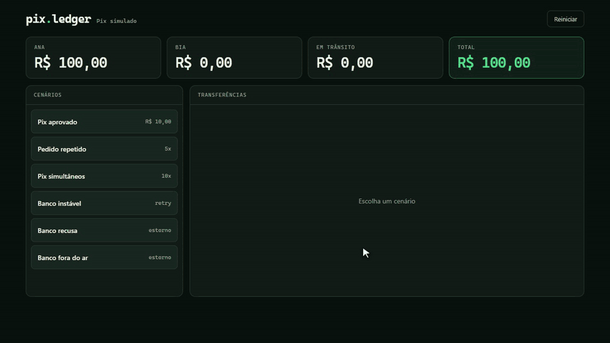
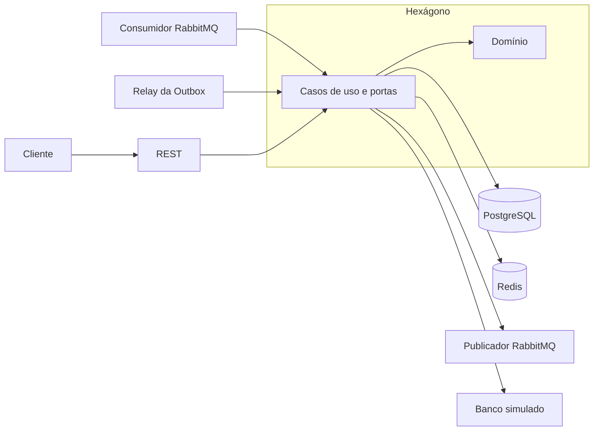
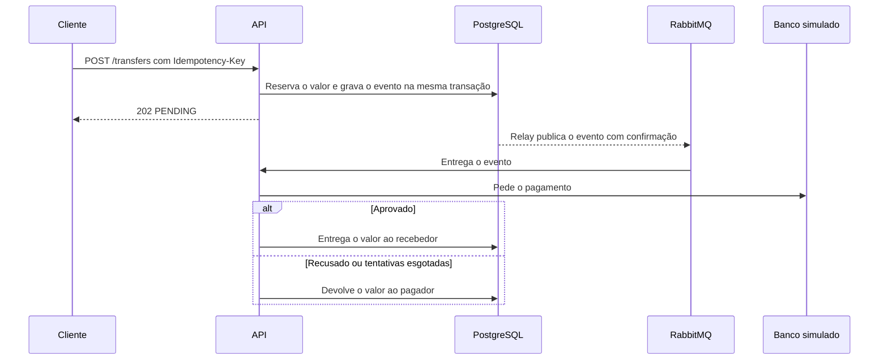

# PixLedger

Carteira digital com transferências Pix **simuladas**, livro-razão de partidas dobradas e arquitetura hexagonal em **Java 8**.

Projeto de portfólio. Não tem integração com o Pix real, com bancos ou com dados de pessoas.



## O que ele resolve

| Problema | Solução |
|---|---|
| Dois Pix gastando o mesmo saldo | Travas de linha, sempre na mesma ordem para evitar deadlock |
| Cliente reenvia o pedido | `Idempotency-Key` garantida pelo PostgreSQL |
| Saldo divergente | Saldo calculado de um livro-razão imutável, em que toda transação fecha em zero |
| RabbitMQ fora do ar | Transactional Outbox: a API segue aceitando pedidos e os eventos saem quando ele voltar |
| Banco externo instável | Retentativas com backoff e estorno automático quando elas acabam |
| Mensagem repetida ou inválida | Consumidor idempotente e fila de erro |
| Redis fora do ar | Ele é só cache, e o PostgreSQL continua sendo a garantia |

## Arquitetura



```text
domain/         regras de negócio puras, sem framework
application/    casos de uso e portas
adapters/in/    REST, consumidores de eventos e agendador
adapters/out/   PostgreSQL, Redis, RabbitMQ e banco simulado
config/         único lugar que conhece as implementações
```

As dependências apontam para o domínio. Os testes com **ArchUnit** fazem o build falhar quando uma camada viola essa regra.

## Fluxo de uma transferência



## Como rodar

Requer Docker.

```powershell
Copy-Item .env.example .env
```

```powershell
docker compose up --build
```

- Demonstração: <http://localhost:8080>
- Swagger: <http://localhost:8080/swagger-ui.html>
- Saúde da aplicação: <http://localhost:8080/actuator/health>

As portas podem ser trocadas no `.env`.

## Banco externo simulado

O resultado depende dos centavos da transferência:

| Centavos | Comportamento |
|---|---|
| `,13` | Recusa e devolve o valor |
| `,98` | Falha duas vezes e depois aprova |
| `,99` | Fica indisponível e, após as tentativas, devolve o valor |
| Outros | Aprova |

## Testes

Requer JDK 8 e Docker. O build recusa outras versões do Java.

```powershell
$env:JAVA_HOME = "C:\caminho\para\jdk-8"
```

```powershell
.\mvnw.cmd verify
```

Os testes de integração usam PostgreSQL, Redis e RabbitMQ reais com Testcontainers, incluindo 100 transferências simultâneas e queda dos serviços.

## Stack

Java 8, Spring Boot 2.7, Spring JDBC, PostgreSQL, Flyway, RabbitMQ, Redis, JUnit 5, ArchUnit, Testcontainers, Docker e GitHub Actions.

O Spring Boot 2.7 é a última linha compatível com Java 8 e não tem mais suporte gratuito. A escolha é intencional, para representar a manutenção de sistemas legados.

## Limitações conhecidas

- Não há autenticação, para manter o foco no fluxo financeiro.
- O estorno automático assume que o banco indisponível não processou o pagamento. Em produção, um timeout é ambíguo e exigiria consulta de status ou conciliação antes de devolver o valor.
- Mensagens na fila de erro precisam de análise e reprocessamento manual.
